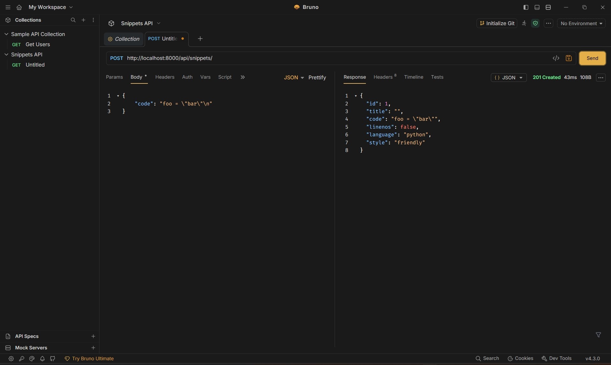
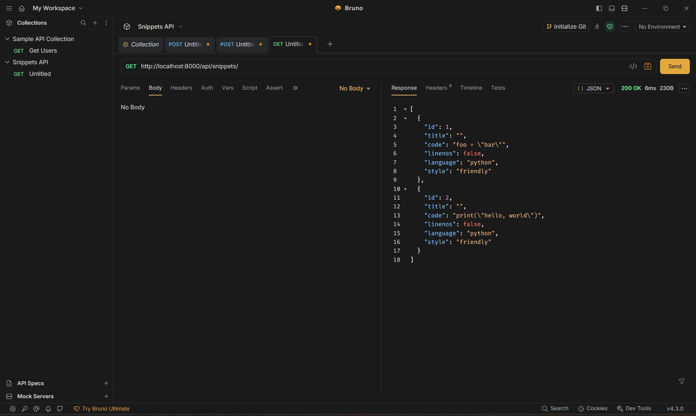
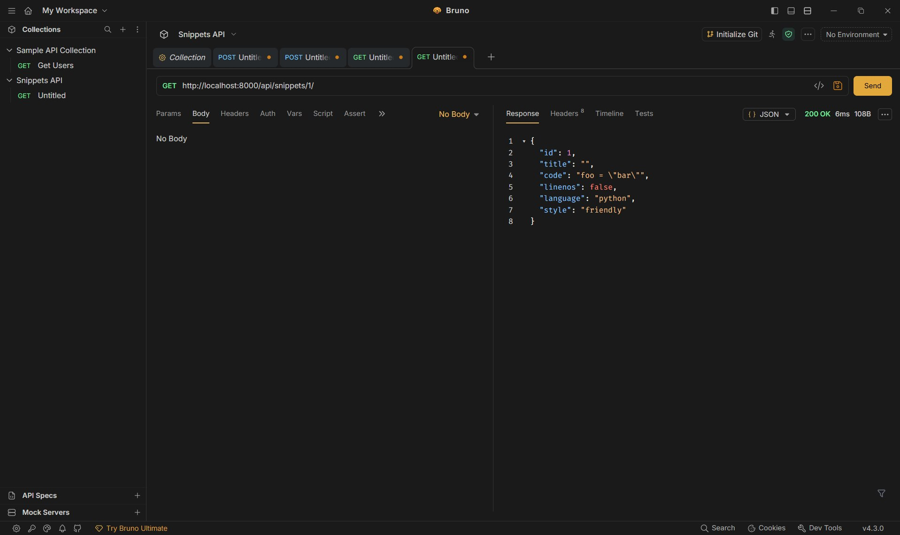
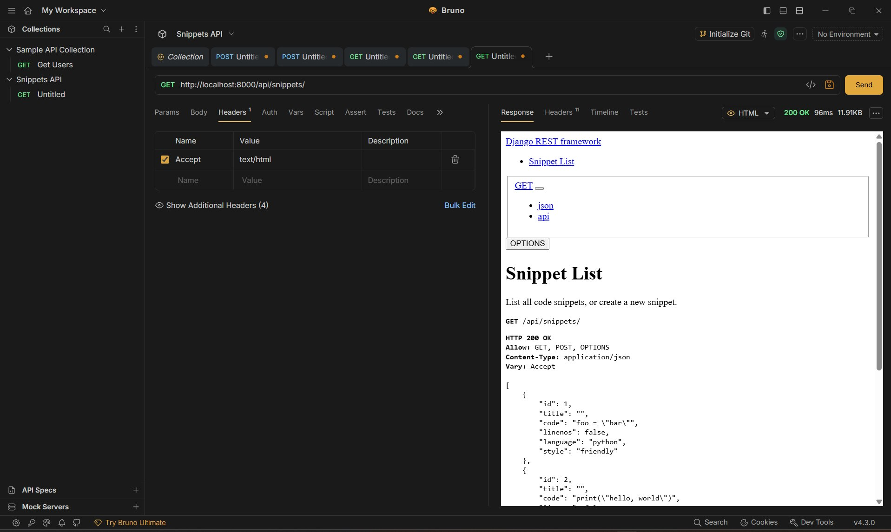
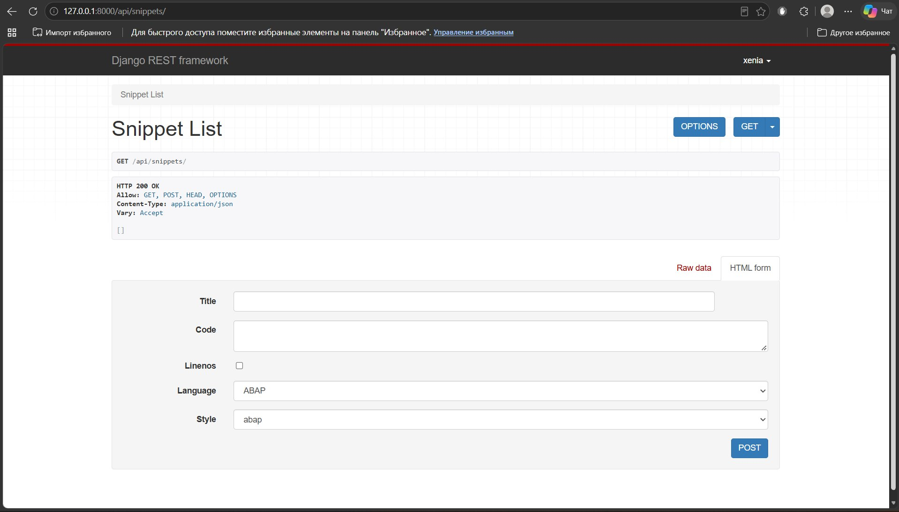
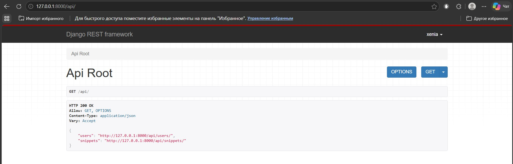

# Snippets API (Django REST Framework)

Учебный проект по созданию, хранению и обмену фрагментами кода (сниппетами) на базе фреймворка Django REST framework. Проект включает подсветку синтаксиса, аутентификацию, разграничение прав доступа и гиперссылки.

## Как запустить проект
1. Установите зависимости:
   `pip install -r requirements.txt`
2. Примените миграции:
   `python manage.py migrate`
3. Запустите сервер:
   `python manage.py runserver`

API будет доступно по адресу: `http://127.0.0.1:8000/api/`

## Тестирование API (Bruno)
Скриншоты работы API с помощью клиента Bruno находятся в папке `docs`.

**1. Создание сниппета**

**2. Список сниппетов**

**3. Один сниппет**

**4. HTML-представление**

**5. Авторизованный пользователь**

**6. Корневая точка входа**
